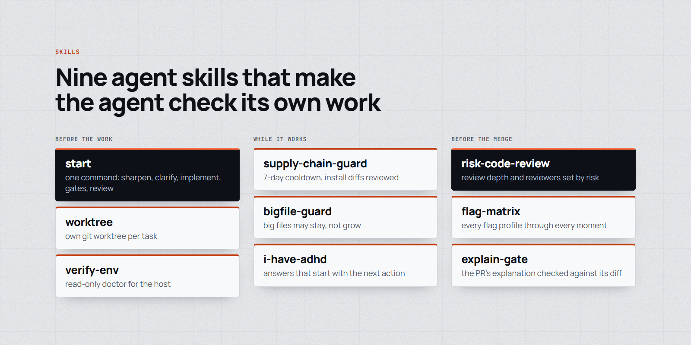

# skills

<p align="center">
  <picture>
    <source media="(prefers-color-scheme: dark)" srcset="docs/assets/skills-dark.png">
    
  </picture>
</p>

<p align="center">
  <a href="https://github.com/MarcinSufa/skills/actions/workflows/ci.yml"></a>
  <a href="LICENSE"></a>
  
</p>

Agent skills for Claude Code (they also work in other agents that read `SKILL.md` folders). Each skill folder has a `README.md` for people and a `SKILL.md` for the agent. Upstream skills credit their authors; "own" means written here.

### Before the work

| Skill | What it does | Upstream |
| --- | --- | --- |
| [start](skills/start/README.md) | `@start <task>` pipeline: sharpen, clarify, implement, gates, review, lessons | own |
| [worktree](skills/worktree/README.md) | Own git worktree per substantive task, with keep or remove rules | own |
| [verify-env](skills/verify-env/README.md) | Read-only doctor for the host and session before a long run | own |

### While it works

| Skill | What it does | Upstream |
| --- | --- | --- |
| [conduct](skills/conduct/README.md) | Multi-model orchestration: the driving session briefs and adjudicates, workers from several vendors implement and review | own |
| [supply-chain-guard](skills/supply-chain-guard/README.md) | Release cooldown for package managers plus a hook that diffs what an install would add | own |
| [bigfile-guard](skills/bigfile-guard/README.md) | Flags staged text files over about 5000 tokens that are new or grew, so agents can read files whole | own |
| [i-have-adhd](skills/i-have-adhd/README.md) | Answers shaped for an ADHD reader: next action first, numbered steps, no filler | adapted from ayghri (MIT) |
| [promote-lessons](skills/promote-lessons/README.md) | Turns queued corrections into guard-hook rules and skill edits, each approved and tested | own |

### Before the merge

| Skill | What it does | Upstream |
| --- | --- | --- |
| [risk-code-review](skills/risk-code-review/README.md) | Code review whose depth and reviewers follow the risk of the change | own |
| [flag-matrix](skills/flag-matrix/README.md) | Tests a change that reads a flag or config setting across every flag profile and read moment | own |
| [explain-gate](skills/explain-gate/README.md) | Checks a PR's What / Why / Risk explanation against its diff | own |

## Also recommended

Skills by other authors that this setup uses, installed from their sources:

- [mattpocock/skills](https://github.com/mattpocock/skills) (MIT): `grilling`, `diagnosing-bugs`, `resolving-merge-conflicts`, `to-questionnaire`, `wait-what`, `writing-for-agents`.
- [visual-explainer](https://github.com/nicobailon/visual-explainer) (MIT): self-contained HTML pages built around figures.
- [graphify](https://github.com/Graphify-Labs/graphify) (Apache-2.0): code, docs and media to a queryable knowledge graph.

Also by the same author: [claude-prompt-ab](https://github.com/MarcinSufa/claude-prompt-ab) measures whether a system prompt change actually changed the output, instead of guessing from one run.

## Install

Copy the skills you want into `~/.claude/skills/` (all projects) or `<repo>/.claude/skills/` (one project):

```bash
git clone https://github.com/MarcinSufa/skills
cp -r skills/skills/risk-code-review ~/.claude/skills/
```

Some skills also ship hooks or scripts; their README says how to turn them on. Nothing is enabled by copying.

## Tests

```bash
node --test $(find . -type f -name '*.test.mjs')
```

## License

MIT for the own skills (see `LICENSE`). Upstream skills keep their authors' licenses, named in the table and in their folders.
