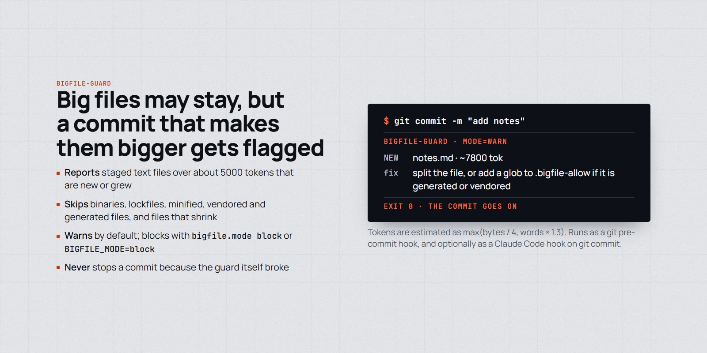
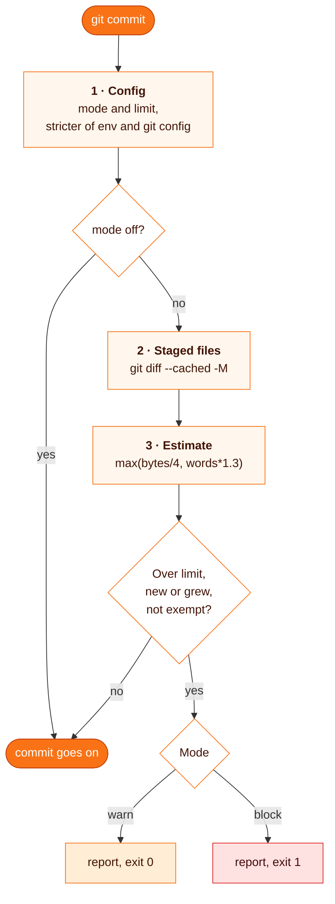

# bigfile-guard

**Stops big files from getting bigger: at commit time it reports any staged text file over about 5000 tokens that is new or grew, so agents keep working on files they can read whole.**

<p align="center">
  <picture>
    <source media="(prefers-color-scheme: dark)" srcset="assets/bigfile-guard-dark.png">
    
  </picture>
</p>

```
$ git commit -m "add notes"
bigfile-guard: 1 file(s) over 5000 tokens (mode=warn):
  NEW  notes.md  ~7800 tok
  Split the file, or add a glob to .bigfile-allow if it is generated or vendored.
```

| | |
| --- | --- |
| **Fires** | as a git `pre-commit` hook, and optionally as a Claude Code PreToolUse hook on `git commit` commands |
| **Reports** | staged text files over the limit that are new, or larger than in `HEAD` |
| **Skips** | binary files, files that stay the same size or shrink, lockfiles, minified, vendored, generated, fixture and dataset paths |
| **Default** | warn only; blocks when the repo sets `bigfile.mode block` or the environment sets `BIGFILE_MODE=block` (the stricter of the two wins) |
| **Never** | stops a commit because the guard itself broke (not a repo, git missing) |
| **Needs** | Node, git; no dependencies |

## Why

Agents read large files in parts and edit them less reliably. Splitting a huge file after the fact is a project; refusing to let it grow is cheap. The guard leaves existing big files alone until a commit makes them bigger. Warn is the default because growth of an already big file counts at any size: measured on the last 50 commits of two repos at limit 5000, a blocking rule would have flagged 32% and 62% of commits.

## How it works



1. **Config.** `BIGFILE_MODE` / `BIGFILE_LIMIT` (env) and `bigfile.mode` / `bigfile.limit` (git config). When both are set the stricter wins (`off` < `warn` < `block`, the lower limit), so `BIGFILE_MODE=off git commit` cannot undo a repo's `block`. An invalid value prints a warning and is ignored.
2. **Staged files.** Read from the index. A rename compares against the old path. Deletions are dropped.
3. **Estimate.** No tokenizer runs offline, so the limit is approximate (tens of percent off, more for non-English text). A file with a NUL byte in its first 8000 bytes is binary and skipped. A staged blob git cannot read is estimated from its size, never passed as empty.

Exemptions: the default list in `hooks/lib.mjs` (`DEFAULT_ALLOW`), plus globs in `.bigfile-allow` at the repo root, one per line, `#` for comments. The file is read from the index, so it counts only once staged. A glob without `/` matches the file name anywhere; with `/` it matches the repo-relative path.

The Claude Code hook runs the same check before a `git commit` the agent is about to run. It finds the repo from the command text (`cd`, `pushd`, `Set-Location`, `git -C`), denies with the report as the reason in block mode, and adds a `systemMessage` in warn mode.

## Install

```bash
git clone https://github.com/MarcinSufa/skills
cp -r skills/skills/bigfile-guard ~/.claude/skills/
```

Nothing is enabled by copying. Opt in per repo, per host, or both.

Git hook, per repo (`.git/hooks/pre-commit`, executable). If the repo already has one, add the `node` line to it:

```sh
#!/bin/sh
exec node "$HOME/.claude/skills/bigfile-guard/hooks/pre-commit.mjs"
```

Block mode for that repo: `git config bigfile.mode block`.

Claude Code hook, per host, in `~/.claude/settings.json`:

```json
{
  "hooks": {
    "PreToolUse": [
      {
        "matcher": "Bash|PowerShell",
        "hooks": [
          {
            "type": "command",
            "command": "node \"$HOME/.claude/skills/bigfile-guard/hooks/claude-pretooluse.mjs\"",
            "timeout": 10
          }
        ]
      }
    ]
  }
}
```

With both installed, warn mode shows the report twice.

Tests: `cd ~/.claude/skills/bigfile-guard && npm test` (22 tests; two command-parsing tests expect POSIX paths and fail on Windows).

## Usage

When a file is reported:

- Split it along its seams (one module per concern, tests next to the module they test) and commit the split.
- If it is generated, vendored or a dataset, add a glob to `.bigfile-allow` in the same commit and say why in the message.

```
# .bigfile-allow
docs/api/openapi.json
*.fixture.json
```

In block mode the agent is told not to use `--no-verify` or move the content to another big file, and to ask you instead.

## Limits

- `git commit --no-verify` skips the git hook.
- The Claude hook reads only the command text: aliases, scripts, `$repo`, `~` and `--git-dir` are not resolved, `git commit -a` and `git commit <path>` stage files it never sees, and `echo 'git commit'` counts as a commit. The git hook is the gate; the Claude hook tells the agent why.

## Files

| File | For |
| --- | --- |
| [`SKILL.md`](SKILL.md) | the agent: the rule, what to do when a file is reported, config |
| [`hooks/lib.mjs`](hooks/lib.mjs) | shared check: estimate, exemptions, config, report |
| [`hooks/pre-commit.mjs`](hooks/pre-commit.mjs) | git pre-commit entry |
| [`hooks/claude-pretooluse.mjs`](hooks/claude-pretooluse.mjs) | Claude Code PreToolUse entry |
| [`test/bigfile-guard.test.mjs`](test/bigfile-guard.test.mjs) | tests against real temp repos |
| `README.md` | you |
