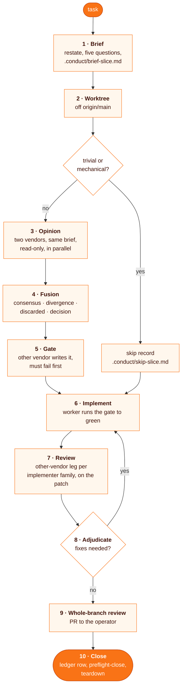

# conduct

**The driving session becomes a conductor: it writes the brief, gets the approach from two vendors, has a third party write a failing gate, routes every code change to a worker, and closes the slice only when a reviewer from another vendor has checked the exact diff.**

> Requires [`superpowers`](https://github.com/obra/superpowers) (obra/superpowers): its `subagent-driven-development` skill runs the Claude-family workers and `dispatching-parallel-agents` runs parallel ones. The other worker CLIs are optional, one per routing row: `codex` for the GPT legs, `grok` for the Grok and DeepSeek legs, Cursor for Composer. A row whose CLI is not installed is recast to a vendor you have. The routing table names the models this setup used; replace it with yours.

```
"route this to a worker"            # the agent loads conduct and stops editing code itself
"get a second vendor's opinion on the cache design"
```

| | |
| --- | --- |
| **Fires** | a coding task the session is tempted to implement itself, a spec decision that needs more than one vendor's view, a change that needs an independent review leg |
| **Does** | brief, opinion from two vendors, fusion, gate, implement by a worker, cross-vendor review, adjudicate, close with a ledger row and a mechanical preflight |
| **Needs** | `superpowers`, Node 22+, git; optional: `codex`, `grok`, a Cursor API key, a memory sink for decisions |
| **Never** | edits product or test code from the driving session, lets the implementer's vendor write its own gate or review, merges (the operator does) |

## Why

One model deciding, building and checking its own work repeats its own blind spots three times. Splitting the roles across vendors puts the value where they disagree: the divergence between two opinion legs is the input to the decision, and a review from another vendor catches what the implementer's family misses. Keeping the driving session out of the code keeps its context clean for coordination over a long program, and the `.conduct/` artifacts let anyone audit every leg afterwards.

## How it works



Rules the skill carries:

- **Flat dispatch.** Only the driving session dispatches legs, and it notes each leg's handle and worktree, so no leg keeps writing after it was judged dead.
- **Patch, not repo.** Review legs get `.conduct/<slice>-diff.patch` from `preflight-close.mjs --diff-patch`, stamped with a hash of the slice state; a review of an older state does not count at close.
- **Gate before build.** The gate is written from the spec by a vendor that does not implement, must fail on the empty tree, and must be shown satisfiable.
- **Token hygiene.** Effort is a tier, big files go through `scripts/bulk-read.mjs` instead of the driving session's context, and one task per worker dispatch.
- **Preflight close.** `scripts/preflight-close.mjs` checks the ledger row, gate evidence, opinion legs, fusion doc and review coverage; a red preflight blocks the close.

## Conductor guard

`settings/conductor-settings.json` adds a PreToolUse hook (`scripts/conductor-guard.mjs`) for the main thread of a conductor session. Edit and Write calls pass only for conductor artifacts (`.conduct/`, prose under `briefs/`, `specs/`, `plans/`, `docs/`, and `$CONDUCT_BRIEF_DIR`); Bash commands are parsed for file writes. Subagents are not guarded, since they are the workers. It is a hook rather than `permissions.deny` because a deny rule would also bind those subagents.

`CONDUCT_GUARD` sets the mode: unset or `shadow` logs each would-be denial to `$CONDUCT_HOME/conductor-guard-shadow.ndjson` without blocking, `enforce` blocks, `off` disables it. Review the shadow log before switching to `enforce`.

The Bash check is a heuristic, not a sandbox. Known escapes: a script file or package script that writes as a side effect (`node build.mjs`, `npm run gen`), tools outside the hook's matcher (MCP tools, for example), and anything the parser cannot read, such as commands assembled at run time.

## Install

```bash
git clone https://github.com/MarcinSufa/skills
cp -r skills/skills/conduct ~/.claude/skills/
```

Then:

1. Install [`superpowers`](https://github.com/obra/superpowers) as its README describes.
2. Optional event hooks (leg lifecycle into `.conduct/events.ndjson`), once per machine: `node ~/.claude/skills/conduct/scripts/install-hooks.mjs --settings ~/.claude/settings.json --scripts-dir ~/.claude/skills/conduct/scripts`; `--uninstall` reverses it. State lives in `$CONDUCT_HOME` (default `~/.conduct-events`).
3. Optional guard: start conductor sessions with `claude --settings ~/.claude/skills/conduct/settings/conductor-settings.json`, and set `CONDUCT_SKILL_DIR` if the skill lives elsewhere.
4. Optional bulk-read: `DEEPSEEK_API_KEY` or `OPENAI_PLATFORM_KEY`, and `BULK_READ_DENY_PATHS` (`;`-separated path tokens, e.g. `acme;client-repo`) for code that must never go to a third-party model. Unset, it denies secret-looking path segments (dotenv files, `.ssh`, `.aws`, `.gnupg`, `secret`, `credential`); setting it replaces that list.
5. Edit the routing table in `SKILL.md` to the models and CLIs you have.

## Files

| File | For |
| --- | --- |
| [`SKILL.md`](SKILL.md) | the agent: the Iron Rule, routing table, loop and rule index |
| [`references/`](references/) | the agent: one file per rule (loop, opinion and fusion, gate, routing, per-vendor contracts, ledger, teardown, token hygiene, bulk-read, casting race, portless preview) |
| [`scripts/preflight-close.mjs`](scripts/preflight-close.mjs) | mechanical close check and the stamped review patch |
| [`scripts/reap.mjs`](scripts/reap.mjs) | report-first worktree reaper |
| [`scripts/conduct-events.mjs`](scripts/conduct-events.mjs), [`scripts/install-hooks.mjs`](scripts/install-hooks.mjs) | orchestration events and the hooks that record them |
| [`scripts/conductor-guard.mjs`](scripts/conductor-guard.mjs), [`settings/conductor-settings.json`](settings/conductor-settings.json) | the conductor guard |
| [`scripts/bulk-read.mjs`](scripts/bulk-read.mjs), [`scripts/grok-diet.mjs`](scripts/grok-diet.mjs), [`scripts/portless-preview.mjs`](scripts/portless-preview.mjs) | big-file reads, the Grok token diet, per-worktree dev server previews |
| `README.md` | you |
