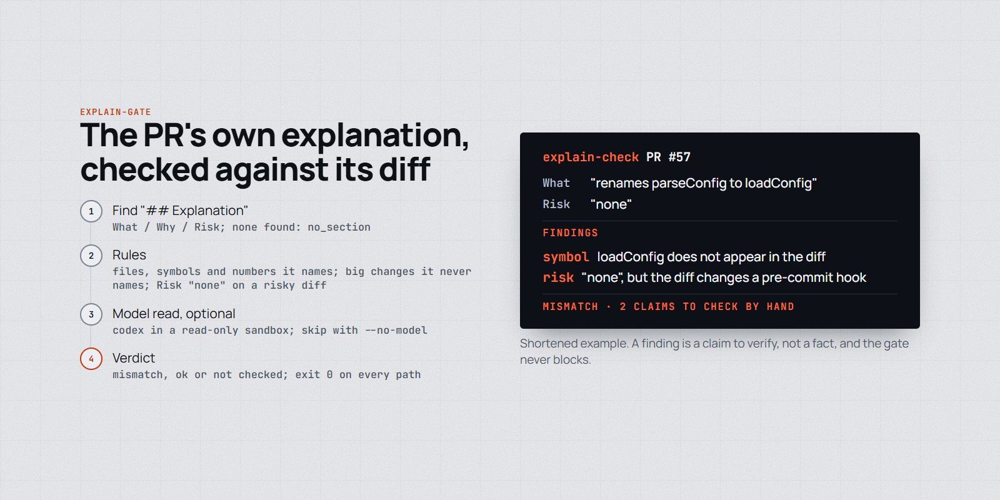
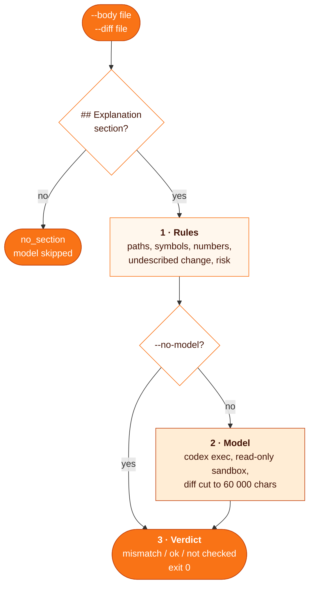

# explain-gate

**Checks that a PR's own explanation matches its diff: the "## Explanation" section (What / Why / Risk) is compared with the changes by deterministic rules and an optional model read, and every mismatch comes back as a warning.**

<p align="center">
  <picture>
    <source media="(prefers-color-scheme: dark)" srcset="assets/explain-gate-dark.png">
    
  </picture>
</p>

```sh
gh pr view 123 --json body -q .body > /tmp/body.md
gh pr diff 123 > /tmp/pr.diff
node ~/.claude/skills/explain-gate/scripts/explain-check.mjs --body /tmp/body.md --diff /tmp/pr.diff
```

| | |
| --- | --- |
| **Fires** | when writing or reviewing a PR description, or reading an explain-gate report; nothing runs it automatically |
| **Checks** | files, symbols and numbers the text names, big changes it never names, a Risk of "none" on a risky diff |
| **Returns** | `mismatch`, `ok` or `not checked`, with one line per finding; `--json` for the full report |
| **Never** | blocks: the script exits 0 on every path, including bad arguments, a missing codex and a timeout |
| **Needs** | Node, no dependencies; `gh` to fetch the PR; the [`codex`](https://github.com/openai/codex) CLI for the model check (skip it with `--no-model`) |

## Why

An author, often an agent, can hand in a PR whose description says things the diff does not do: a function that was renamed, a file that was never touched, a Risk of "none" on a change to a hook that runs on every commit. A gate that checks a review and proof exist does not check that the author understands the change. This compares the author's own words with the diff and reports the claims that do not hold. Each finding is a claim to verify by hand, not a fact.

## How it works



### 1. Rules

Milliseconds, no network.

- `no_section`, `missing_field`: no `## Explanation`, or an empty What, Why or Risk.
- `file_not_in_diff`: a path in the text the diff does not touch. Sentences like "X is unchanged" are skipped.
- `symbol_not_in_diff`: a backticked token or `name()` in What or Risk that appears nowhere in the diff.
- `number_not_in_diff`: a number of 2+ digits in What that is absent from the diff (dates, `#12` refs and SHAs are skipped). Weak on big diffs.
- `undescribed_change`: a non-test file with 30+ changed lines the text never names.
- `risk_omitted`: Risk "none" on a diff that removes 20+ lines or touches a risky path. The list is the `RISKY_PATH` regex in the script: `hooks/`, `bin/`, `.github/`, plus `manifest.json`, `sync.mjs` and `release.mjs` from the repo it was written for. Edit it to name the files that run automatically in yours.

### 2. Model

`codex exec --sandbox read-only` gets the prompt on stdin: the explanation, the file list and the diff cut to 6000 characters per file and 60 000 in total. It replies `{"mismatches":[{field,claim,evidence}],"verdict":"ok|mismatch"}`. It looks for wrong files, functions or numbers, behaviour described in reverse, a motivation the diff contradicts, a significant omitted change, and a Risk that denies a risk the diff creates. Incomplete Risk and outside numbers in Why are not reported. Timeout 900 s by default.

### 3. Verdict

`mismatch` if any rule or the model found one; `not checked` if the model could not run or replied without valid JSON; otherwise `ok`.

## Install

```bash
git clone https://github.com/MarcinSufa/skills
cp -r skills/skills/explain-gate ~/.claude/skills/
```

Nothing is wired up by copying. Run it by hand, or call it from your PR flow as a warning. Do not make a PR wait on it.

| Flag / env | Effect |
| --- | --- |
| `--no-model` | rules only |
| `--json` | full report: `verdict`, `deterministic[]`, `model` |
| `--timeout <sec>` / `EXPLAIN_TIMEOUT` | codex time limit, default 900 |
| `EXPLAIN_CODEX` | codex binary, default `codex` |

Tests: `cd ~/.claude/skills/explain-gate && npm test`. The model tests use a fake codex script.

## Example

The section it expects in the PR body (recommended, not required):

```markdown
## Explanation

What: what the diff changes: files, functions, flags, behaviour before and after. Names in `backticks`.
If something is deliberately NOT changed, write "X is unchanged".

Why: the reason. Numbers and incidents from outside the diff come with their source.

Risk: what can break and for whom. "None" only for changes with no runtime effect.
```

A body naming `retryFetch()` and `src/api/client.ts` with Risk "none", against a diff that adds `fetchWithRetry` and edits `hooks/pre-push.mjs`, run with `--no-model`:

```
[explain-gate] mismatch (warn only)
- rule file_not_in_diff (what): names src/api/client.ts, which the diff does not touch
- rule symbol_not_in_diff (what): names `retryFetch()`, which appears nowhere in the diff
- rule risk_omitted (risk): Risk says "none" but the diff touches hooks/pre-push.mjs
```

Real output from the script on a small made-up PR. When codex cannot run, the report adds a line such as `- model not checked: codex timed out after 900 s`.

## Limits

- Measured on 6 PRs with one planted error each plus 6 correct explanations, 2 runs each: the checker caught the planted error in 12 of 12 runs; the model alone flagged 1 of 10 runs on the 5 truly correct explanations. The prompt was tuned on the same set, so the false alarm rate is optimistic.
- One run is noisy: the model's verdict agreed between two runs on 10 of 12 cases.
- Cost per model check: median about 19 s and 10.5k tokens, up to 145 s and 56k tokens on a 435 KB diff.
- Rules miss some wrong claims: a flag or dotted name matches as a substring, a path matches a longer one, and paths with spaces or git-quoted paths are not parsed.
- On a cut diff the model can miss or misreport what lies in the cut part.
- The diff is sent to the codex provider, the same exposure as a codex review.

## Files

| File | For |
| --- | --- |
| [`SKILL.md`](SKILL.md) | the agent: the section format, how to run it, how to read findings |
| [`scripts/explain-check.mjs`](scripts/explain-check.mjs) | the checker: rules, model call, report |
| [`test/explain-gate.test.mjs`](test/explain-gate.test.mjs) | rule and parser tests, model path with a fake codex |
| `README.md` | you |
