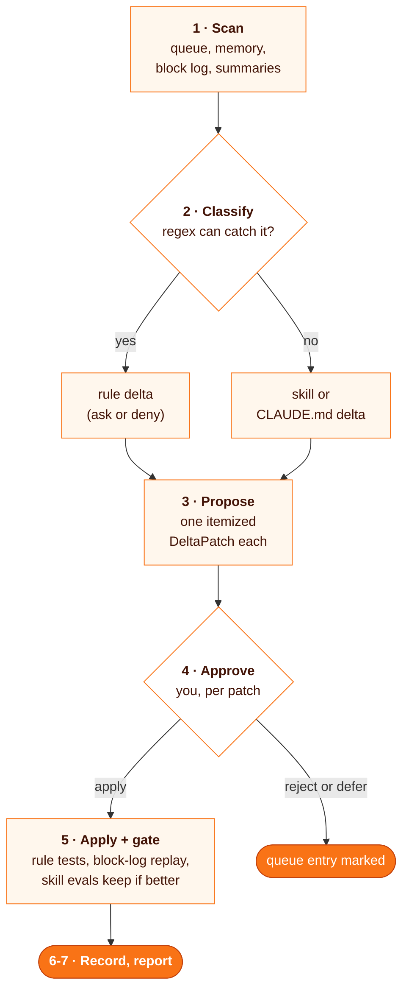

# promote-lessons

**A curation pass that turns the corrections your agent collected into guard-hook rules and skill edits, each one approved by you and tested before it stays.**

> Built around a PreToolUse guard hook with a JSON rules file and a Stop hook that queues corrections. Neither ships here: the skill names them as placeholders, and your `CLAUDE.md` says where yours live. A source you do not have is skipped.

```
/promote-lessons
```

| | |
| --- | --- |
| **Fires** | when you ask to promote lessons or curate corrections, or as a periodic pass |
| **Reads** | a lesson queue, a memory store, the guard hook's block log, session summaries (whichever exist) |
| **Writes** | itemized deltas to the rules file, a `SKILL.md` or a `CLAUDE.md`, only after you approve each one |
| **Never** | applies a delta without your approval, rewrites a rules file whole, or reads secret files to test a rule |

## Why

Corrections given in chat fade with the session. The ones a regex can catch belong in a hook that blocks the mistake; the rest belong in the skill that made it. Writing those by hand each time does not happen, so a periodic pass proposes them and you only approve.

## How it works



- **Rules get tests.** A new rule lands with a test case, and the recent block log is replayed so nothing benign that passed before is blocked now.
- **Skills get evals.** A skill with an `evals.json` is scored in a fresh `claude -p` session before and after the edit; a drop reverts it.
- **The queue is append-safe.** The pass re-reads the queue right before marking entries, so lessons the hook added meanwhile stay pending.

## Install

```bash
git clone https://github.com/MarcinSufa/skills
cp -r skills/skills/promote-lessons ~/.claude/skills/
```

Then tell the agent, in your `CLAUDE.md`, where your rules file, its test, the block log and the lesson queue live.

## Files

| File | For |
| --- | --- |
| [`SKILL.md`](SKILL.md) | the agent: sources, classification, DeltaPatch format, approval and fitness gates |
| `README.md` | you |
