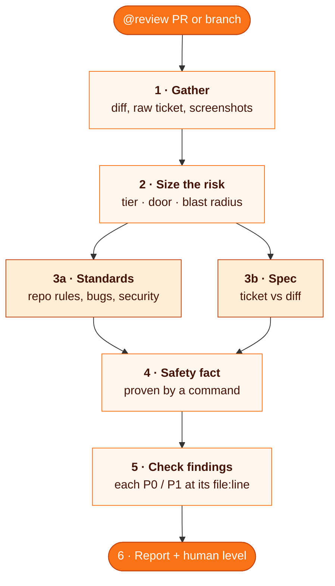
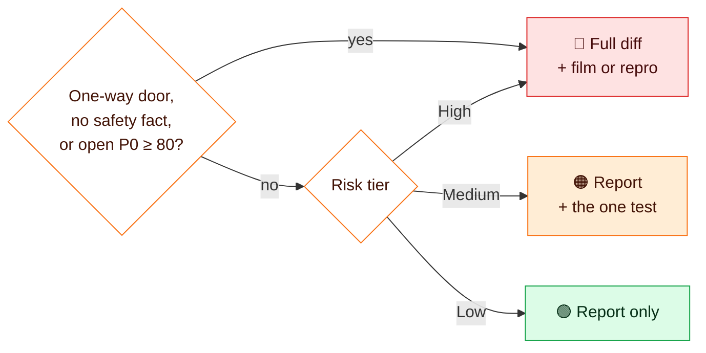
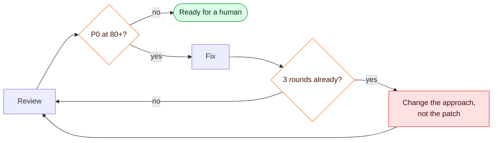

# risk-code-review

**Code review whose depth follows the risk of the change.** Fresh-context reviewers picked by the tier, at least one from another vendor than the writer when one is installed, review it, and the report ends with how much a human still has to check.

<p align="center">
  <picture>
    <source media="(prefers-color-scheme: dark)" srcset="assets/risk-code-review-dark.png">
    
  </picture>
</p>

```
@review 3241              # a PR number or URL
@review feat/my-branch    # a branch, diffed against its base
```

An agent runs the same skill as the review step of its own change, so there is one set of review rules for people's and agents' PRs.

| | |
| --- | --- |
| **Reads** | the diff, the raw ticket and the reporter's screenshots |
| **Reviews** | the roster's reviewers for the tier, each in two separate passes, Standards and Spec |
| **Proves** | one safety fact, with a command and its output |
| **Returns** | tier, door, findings per axis, and the human review level |
| **Leaves to you** | approving, requesting changes, merging, posting to GitHub |

## The process



### 1. Gather

The diff, the original ticket and the reporter's screenshots, saved before any review starts. The reviewer reads the ticket itself, never an AI summary of it. With no ticket, the Spec pass reviews against the PR description and says so.

### 2. Size the risk

**Risk tier.** The highest tier any touched file falls in, from the project's own list (its `REVIEW.md` or `CLAUDE.local.md`). A small diff keeps its tier: one line in a price calculation is still High.

| Tier | Typical files | Review depth |
| --- | --- | --- |
| 🔴 High | saving data, money, config and flags, permissions | full diff, reviewer runs the tests, answers the P0 / Proof questions |
| 🟠 Medium | other stores, services, routing, screens | diff plus one test showing the new behaviour |
| 🟢 Low | copy, styles, docs, test-only changes | quick read, still recorded |

With no list in the project: High for code that saves data, moves money, reads config or checks permissions.

**Door.** Whether a revert undoes the change.

| One-way door | Two-way door |
| --- | --- |
| schema or data migration, data written in a new shape, a changed API or message contract, deleted data, deploy config, messages sent to people | everything a revert fully restores |

**Blast radius.** Every caller of every changed exported function, listed.

### 3. Reviews, picked by the tier

| | Standards | Spec |
| --- | --- | --- |
| **Question** | is the code right? | is it the right change? |
| **Reads** | repo rules (`AGENTS.md`, `CLAUDE.md`, the project's review rubric), the diff | the raw ticket and screenshots, the diff |
| **Looks for** | bugs, security, error handling, data loss | everything asked is done, every symptom the reporter saw is gone, nothing extra was added |

| Tier | Reviewers |
| --- | --- |
| Low, Medium | one fresh-context subagent |
| High | a fresh-context subagent, plus a model from another vendor when one is installed (`codex`, `gemini`, `grok`, `cursor-agent`) |

A project replaces this default with a "Reviewers" section in its REVIEW.md, a person with a roster file their CLAUDE.md points to (models per tier and the command for each).

Every reviewer runs both passes from the same brief and never sees another reviewer's findings. Different models miss different things: on one PR, one model found a test seed that cannot run locally, which the other missed. At least one reviewer is from another vendor than the writer when one is installed, and a reviewer that cannot run is swapped and named in the report. The passes stay separate and are never merged into one verdict. Each finding carries a severity (P0, P1, P2) and a confidence from 0 to 100, plus the reviewers that raised it.

### 4. Safety fact

One fact that makes the change safe to merge, proven by a command run during the review:

> *Every caller passes a saved id.* Proof: `grep -rn "invoiceTotal(" src` lists 3 callers, all after `save()`.

When nothing can be proven, the report says so and the human level goes to the top row.

### 5. Check the findings

Findings are hypotheses. Each P0 and P1 is checked against the code it cites. A finding whose code says something else is dropped, and the report counts the drops.

### 6. Report

```
Tier: High (src/billing/invoice-total.ts)   Door: two-way (a revert restores it)
Safety fact: every caller passes a saved id, proof: grep -> 3 callers, all after save()
Human: reads the full diff and runs the repro
Writer: Claude Opus 5.5   Reviewers: Opus subagent, GPT (codex)

Standards   none above threshold
Spec        none above threshold
Below threshold (go to the PR body)
  P2 60  a tooltip wording differs from the ticket text
Dropped after checking: 1
```

*An illustration, not a real review.*

## How much human



Approving, requesting changes and merging are done by a human at every level.

## Where the result goes

| Someone else's PR | Own branch or own PR |
| --- | --- |
| Report in the chat | Report in the PR body, under "P0 / Proof" |
| A draft GitHub review (summary and inline comments), posted as a comment only after approval | Only a P0 at confidence 80+ starts a fix round; the rest goes into the PR body |
| Their code stays untouched | At most 3 fix rounds per approach, then a new approach |

On your own branch, a fix makes the review stale, so it runs again on the new changes only:



## Where the ideas come from

| Idea | Source | Here |
| --- | --- | --- |
| Separate Standards and Spec reviewers, not one verdict | Matt Pocock, `code-review` skill | step 3 |
| Review in a fresh context, findings as hypotheses, no looping until clean | Matt Pocock, `code-review` skill | steps 3 and 5 |
| "Merge Danger": one-way or two-way door, blast radius | Matt Pocock, `pr` skill | step 2 |
| One fact that makes the change safe, proven by running code | pstack, `blast-radius` | step 4 |
| Stop at merge-ready, merging is a human decision | pstack, `babysit` | human level |
| Risk tiers, cross-vendor reviewer, severity with confidence, round cap | this repo, `REVIEW.md` and the `start` skill | steps 2, 3, 5 |

## Files

| File | For |
| --- | --- |
| [`SKILL.md`](SKILL.md) | the agent: the exact steps it follows |
| `README.md` | you: what it does and why |
