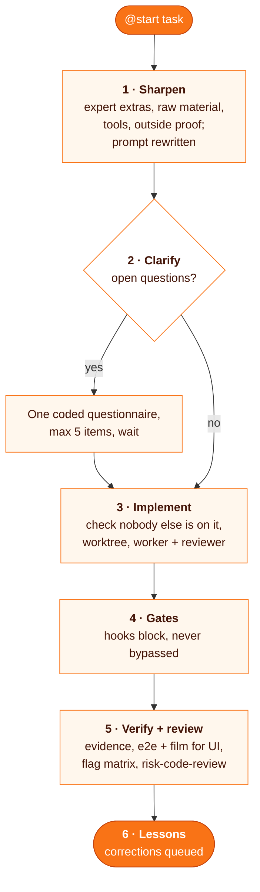

# start

**One command runs a whole task: `@start <task>` sharpens the request, asks open questions once, implements in a worktree, runs the gates, has the result reviewed by fresh reviewers, and queues the lessons.**

> A pipeline skill that names other skills and hooks. It is wired to this setup: the `@start` alias lives in the global `CLAUDE.md`, and the stages call `grilling`, `conduct`, `risk-code-review`, `flag-matrix` and hooks such as never-do. Copy it as a template for your own pipeline rather than as a drop-in. `grilling` and `diagnosing-bugs` come from [mattpocock/skills](https://github.com/mattpocock/skills); a stage whose skill is not installed is skipped.

```
@start fix the duplicate toast after saving an order
```

| | |
| --- | --- |
| **Fires** | when you type `@start <task>`; the later stages start themselves |
| **First output** | four one-line answers and your prompt rewritten, before any tool call |
| **Stops for you** | the clarify answer, a cost gate, and approval to commit or push |
| **Never** | builds a parallel fix when someone else's branch or PR already covers the ticket, or routes around a blocking hook |

## Why

A short request leaves out what an expert would do anyway: start from the raw material, use real tools, and name what outside the model proves the result. Typing those stages every time is tedious, so one alias runs them in a fixed order and stops only where a human decision is needed.

## How it works



1. **Sharpen.** Four answers: what a top expert would add, the rawest material they would start from, their tools beyond reasoning, and what outside the model shows the result is right. For a bug, each thing the reporter saw becomes an assertion with its expected value from the reporter's material, not from the code.
2. **Clarify.** Open architecture or product questions, or scope growth, go into one coded questionnaire through the `grilling` skill. Nothing open: no question.
3. **Implement.** First `git fetch`, then search every remote's commit messages, branch names and PRs for the ticket; someone else's work stops the run. Substantive work goes to an orchestrated worker and reviewer pair in a worktree; a trivial single-file edit is written directly.
4. **Gates.** Hooks run on their own; a block is reported.
5. **Verify and review.** Verification before claiming done. A UI change gets a committed e2e spec and a before/after film. Stubs of external APIs copy recorded responses, redacted. Code that reads a config flag gets a flag x moment matrix. Then `risk-code-review` on the final tree.
6. **Lessons.** If your setup queues corrections (for example from a Stop hook), a periodic pass turns them into rules, not each task.

**Fast path:** a trivial single-file edit (under about 30 lines) skips stages 2 and 3's orchestration; stage 5 still runs.

## Install

```bash
git clone https://github.com/MarcinSufa/skills
cp -r skills/skills/start ~/.claude/skills/
```

Then add an alias to your `CLAUDE.md` so `@start <task>` invokes it, and replace the stage 3 worker and reviewer choice and the skills it names with what you have installed.

## Files

| File | For |
| --- | --- |
| [`SKILL.md`](SKILL.md) | the agent: the six stages and the fast path |
| `README.md` | you |
