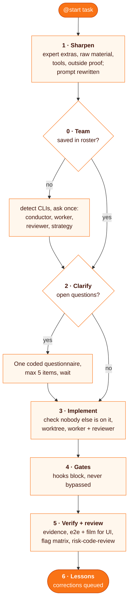

# start

**One command runs a whole task: `@start <task>` sharpens the request, asks open questions once, implements in a worktree with the models you picked, runs the gates, has the result reviewed by another vendor, and queues the lessons.**

> A pipeline made of other skills: [`grilling`](https://github.com/mattpocock/skills) (mattpocock, MIT), [`worktree`](../worktree/README.md), [`conduct`](../conduct/README.md), [`flag-matrix`](../flag-matrix/README.md), [`risk-code-review`](../risk-code-review/README.md), [`promote-lessons`](../promote-lessons/README.md) and `superpowers:verification-before-completion` ([obra/superpowers](https://github.com/obra/superpowers)). A stage whose skill is missing runs a simpler fallback and says so.

```
@start fix the duplicate toast after saving an order
```

| | |
| --- | --- |
| **Fires** | when you type `@start <task>`; the later stages start themselves |
| **First use** | asks once for conductor, worker and reviewer models (from the CLIs it finds) and a default strategy, saved in your roster file; `@start setup` asks again |
| **Strategies** | solo, fan-out (parallel workers), consensus (three models, two rounds, then the conductor decides), review (an existing PR by risk tier) |
| **First output** | four one-line answers and your prompt rewritten, before any tool call (the team setup comes right after) |
| **Stops for you** | the setup and clarify answers, a cost gate, and approval to commit or push |
| **Never** | builds a parallel fix when someone else's branch or PR already covers the ticket, or routes around a blocking hook |

## Why

A short request leaves out what an expert would do anyway: start from the raw material, use real tools, and name what outside the model proves the result. Typing those stages every time is tedious, so one alias runs them in a fixed order and stops only where a human decision is needed.

## How it works



0. **Team and strategy** (right after sharpen's first output). Read once from the roster file your `CLAUDE.md` points to (the one `risk-code-review` reads). Missing: the skill checks which of `claude`, `codex`, `gemini`, `grok`, `cursor-agent` run, asks you to pick the conductor, worker, reviewer and default strategy, and writes a `## Team and strategy` table there. A task can override the strategy with `--fan-out`, `--consensus` or `--review`.
1. **Sharpen.** Four answers: what a top expert would add, the rawest material they would start from, their tools beyond reasoning, and what outside the model shows the result is right. For a bug, each thing the reporter saw becomes an assertion with its expected value from the reporter's material, not from the code.
2. **Clarify.** Open architecture or product questions, or scope growth, go into one coded questionnaire through the `grilling` skill. Nothing open: no question.
3. **Implement.** First `git fetch`, then search every remote's commit messages, branch names and PRs for the ticket; someone else's work stops the run. Substantive work goes to `worktree` and `conduct` with your team: the worker writes, the conductor briefs and adjudicates, and the reviewer is never the worker's vendor. A trivial single-file edit is written directly.
4. **Gates.** Hooks run on their own; a block is reported.
5. **Verify and review.** Verification before claiming done. A UI change gets a committed e2e spec and a before/after film. Stubs of external APIs copy recorded responses, redacted. Code that reads a config flag gets a flag x moment matrix. Then `risk-code-review` on the final tree.
6. **Lessons.** `promote-lessons` runs as a periodic pass that turns queued corrections into rules and skill edits, not per task.

**Fast path:** a trivial single-file edit (under about 30 lines) skips stages 2 and 3's orchestration; stage 5 still runs.

## Install

```bash
git clone https://github.com/MarcinSufa/skills
cp -r skills/skills/start ~/.claude/skills/
```

Install the skills it composes the same way, add an alias to your `CLAUDE.md` so `@start <task>` invokes it, and point your `CLAUDE.md` at a roster file (the first run fills in its team section).

## Files

| File | For |
| --- | --- |
| [`SKILL.md`](SKILL.md) | the agent: team setup, strategies, the six stages and the fast path |
| `README.md` | you |
