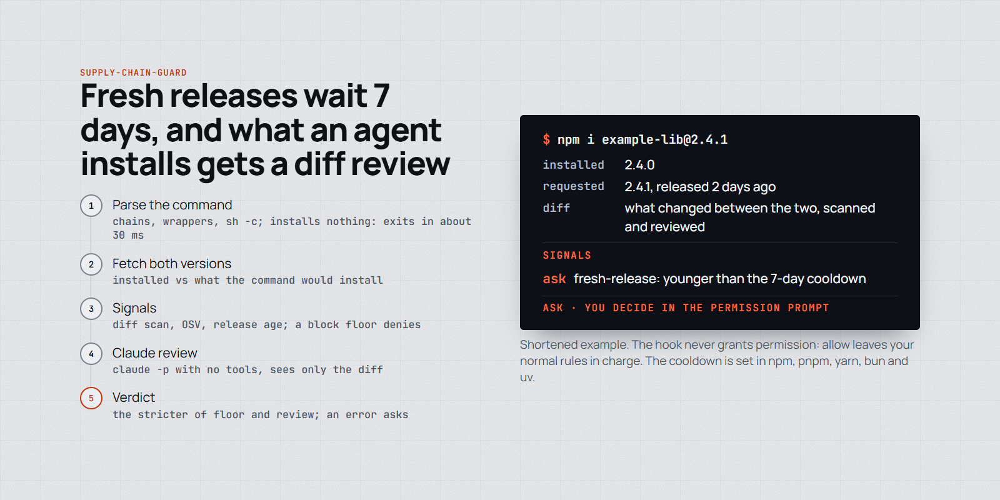
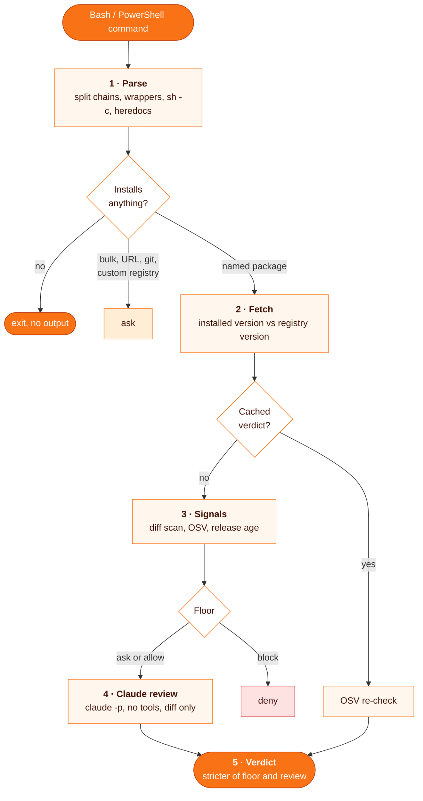

# supply-chain-guard

**Stops a trojaned package or editor extension before it lands: a 7-day release cooldown in your package managers, plus a hook that diffs what a Bash command would install against what you have and lets Claude judge only that diff.**

<p align="center">
  <picture>
    <source media="(prefers-color-scheme: dark)" srcset="assets/supply-chain-guard-dark.png">
    
  </picture>
</p>

```
# the hook fires on its own, before every Bash or PowerShell tool call
npm i axios@1.7.9
cursor --install-extension publisher.ext@2.1.0
pip install requests==2.32.4
```

| | |
| --- | --- |
| **Fires** | PreToolUse on `Bash` and `PowerShell`, every call; a command that installs nothing exits in about 30 ms with no output |
| **Reviews** | npm, pnpm, yarn, bun, `npx`-style runners, pip, uv, pipx, Pipenv, and Open VSX extensions (Cursor, Windsurf, VSCodium) |
| **Returns** | `deny` (block), `ask` (you decide in the permission prompt), or a one-line `systemMessage` on allow |
| **Never** | grants permission (allow leaves your normal rules in charge), or allows on an error: every failure asks |
| **Needs** | Node (no version pinned), the `claude` CLI on PATH (each fresh review is one billed `claude -p` call), network to the registries and OSV, Claude Code 2.1.295+ for `onFailure` |

## Why

Trojaned releases are usually pulled within hours to days, so most of the risk sits in the first week after publication. A real case: on 2026-10-29 the Cursor marketplace served `anthropic.claude-code` 2.1.312 and 2.1.313 builds that were trojaned. An agent that runs `npm i` or `--install-extension` on its own has no human glancing at the package first. The cooldown skips fresh versions in the package manager itself; the hook covers the packages an agent names in a command.

## How it works



### 1. Parse

`hooks/targets.mjs` splits the command on `&&`, `;` and `|`, unwraps `sudo`, `env`, `timeout`, `corepack`, `sh -c "..."`, `$(...)`, `eval` and runners such as `npx -c` or `pnpm exec`, and checks each part. Installs it cannot pin to one name and version ask without a review: bulk upgrades (`npm update`, `uv lock -U`, `pip install -r`), `github:` or URL sources, registry or index overrides (flags, env vars, config files), lockfile bypasses (`--no-lockfile`, `--skip-lock`), package manager self-updates, and managers it does not review (Cargo, Go, Poetry, Conda and others). Lockfile installs (`npm ci`, frozen installs, `uv sync --locked`) pass and rely on the cooldown. SKILL.md has the full table.

### 2. Fetch

The old version is read from the hook's cwd (`node_modules`, `.venv`, `VIRTUAL_ENV`, the editor's extension dirs). The new one is downloaded from the registry and its hash checked. Same version on both sides: allow, nothing new is fetched.

### 3. Signals

`hooks/scan.mjs` diffs old against new. A pattern counts only when the new version has more matches than the old one.

| Floor | Signals |
| --- | --- |
| block | `ssh-keys`, `reverse-tunnel`, an OSV `MAL-*` advisory |
| ask | `install-script`, `persistence`, `credential-access`, `dynamic-code`, `obfuscation`, `ip-literal`, `pth-startup-hook`, `unscannable`, `fresh-release` (younger than the cooldown), load-time code newly added to an entry file |
| Claude decides | `process-exec`, `raw-socket`, `new-endpoint`, `size-jump`, `binary-added`, `symlink`, `eager-activation`, `entry-changed`, `build-script`, other OSV advisories |

### 4. Claude review

Runs only when the floor is not already block: `claude -p --tools "" --strict-mcp-config --setting-sources local` from an empty temp dir, with a JSON schema for the answer. It sees the signals, OSV results and up to 60 000 characters of diff, flagged and entry files first. Everything from the package sits inside one nonce-delimited untrusted block, and an attempt to instruct the reviewer is itself a reason to block.

### 5. Verdict

The stricter of floor and review, so text in a package can tighten the verdict but never loosen it. Verdicts are cached 30 days per package, versions, artifact hash and model in `~/.cache/supply-chain-guard/verdicts/` (not while the release is inside the cooldown); a cache hit is still checked against OSV. Every non-pass decision is appended to `~/.cache/supply-chain-guard/log.jsonl`.

## Install

```bash
git clone https://github.com/MarcinSufa/skills
cp -r skills/skills/supply-chain-guard ~/.claude/skills/
```

Register the hook in `~/.claude/settings.json` (merge into an existing `hooks` block):

```json
{
  "hooks": {
    "PreToolUse": [
      {
        "matcher": "Bash|PowerShell",
        "hooks": [
          {
            "type": "command",
            "command": "node \"$HOME/.claude/skills/supply-chain-guard/hooks/guard.mjs\"",
            "timeout": 120,
            "onFailure": "block"
          }
        ]
      }
    ]
  }
}
```

`onFailure: block` makes a crashed or killed hook block too. Keep `SCG_BUDGET_MS` (default 100 000) below the `timeout`.

Then set the cooldown per user. Minimum versions and settings, from SKILL.md:

| Tool | Minimum | Setting |
| --- | --- | --- |
| pnpm 11 | 11 | `pnpm config set --location=global minimumReleaseAge 10080` |
| pnpm 10 | 10.16 | `minimum-release-age=10080` in `~/.config/pnpm/rc` |
| npm | 11.10 | `npm config set min-release-age 7 --location=user` |
| yarn berry | 4.10 | `yarn config set --home npmMinimalAgeGate 7d` |
| bun | 1.3 | `[install]` `minimumReleaseAge = 604800` in `~/.bunfig.toml` |
| uv | 0.9.17 | `exclude-newer = "7 days"` in `~/.config/uv/uv.toml` |
| pip | 26.1 | `pip config --user set install.uploaded-prior-to P7D` |

To take a fresh release on purpose, override once, for example `pnpm add x --config.minimumReleaseAge=0`. The hook still asks.

Settings (env): `SCG_COOLDOWN_DAYS` (7), `SCG_MODEL` (`sonnet`), `SCG_BUDGET_MS`, `SCG_STATE_DIR`, `SCG_CLAUDE_BIN`, `SCG_EXTENSION_DIRS`, and `SCG_NPM_REGISTRY` / `SCG_PYPI_URL` / `SCG_VSX_API` / `SCG_OSV_URL` for mirrors.

Tests: `npm test` runs a hermetic suite against a local registry, Open VSX and OSV stand-in (`test/registry.mjs`) and a fake reviewer, with no network and no billed calls. The fixtures are built with `tar` and symlinks, so run it on Linux or macOS. `npm run bench` uses the real registries and the real reviewer, so it costs money.

## Example

```
supply-chain-guard block
evil-pkg 1.4.2 -> 1.4.3: block
  - install-script in package.json: "postinstall": "node setup.js"
  - ssh-keys in setup.js: fs.appendFileSync(path.join(home, '.ssh/authorized_keys'), KEY)
```

*An illustration, not real output.* On deny, the agent shows you the reason and stops; it does not retry through another manager, `curl | tar` or a hand-downloaded `.vsix`.

## Limits

- Only packages named in the command are diffed; transitive dependencies and lockfile installs rely on the cooldown.
- For PyPI the guard reviews a pure wheel or sdist; pip may pick a different artifact for your platform.
- Files changed by Claude's Edit or Write tools (`package.json`, `.npmrc`) and code run by `python setup.py`, `node install.js` or `make` are not inspected.
- VS Code Marketplace IDs (`code --install-extension`) ask without a review, since only Open VSX is fetched.

SKILL.md lists every limit.

## Files

| File | For |
| --- | --- |
| [`SKILL.md`](SKILL.md) | the agent: what each verdict means, the full command table, limits, settings |
| [`hooks/guard.mjs`](hooks/guard.mjs) | the hook entry: decision, Claude review, cache, log |
| [`hooks/targets.mjs`](hooks/targets.mjs) | command parser: which packages a command would install |
| [`hooks/sources.mjs`](hooks/sources.mjs) | registry fetch, hash check, unpack, installed version lookup |
| [`hooks/scan.mjs`](hooks/scan.mjs) | diff and signal rules (`RULES` table) |
| [`test/`](test/) | hermetic tests, local registry, fake reviewer, live bench |
| `README.md` | you |
