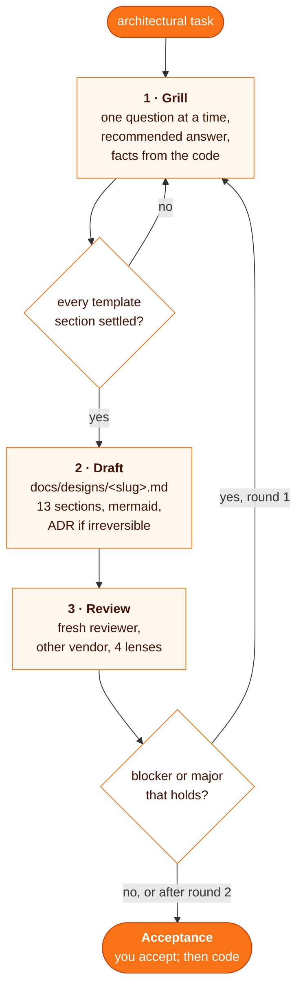

# system-design

**Designs before it builds: grills you one question at a time, writes a design doc from a fixed 13-section template, has it reviewed by a fresh model from another vendor, and waits for your acceptance before any code. Also runs system design interview practice with a score.**

> Ideas, not text, from: [`grilling`](https://github.com/mattpocock/skills) (mattpocock, MIT: the design tree, a recommended answer per question, facts looked up rather than asked, the three-part ADR test); [elephant-goldfish-model](https://github.com/google/elephant-goldfish-model) (Google, Apache-2.0: draft section by section, review by zero-context reviewers, a capped number of re-reviews); [system_design_skill](https://github.com/codeMaestro78/system_design_skill) (codeMaestro78, MIT: the section list, labelled assumptions, interview mode with a hint ladder); [architecture-design-skill](https://github.com/binodta/architecture-design-skill) (binodta, CC BY 4.0: scope written as negation, the verification plan). No text is copied from any of them.

```
design a URL shortener for 100M URLs/day
```

| | |
| --- | --- |
| **Fires** | a new service, data model or cross-component change, a decision costly to reverse, a request for a design doc; also from [`start`](../start/README.md) stage 2 on an architectural task |
| **Asks** | one question at a time, each with a recommended answer, no cap; batch mode (`Q1..Qn`) when you ask for it |
| **Never asks** | what the code already answers: those come with `file:line` |
| **Writes** | `docs/designs/<slug>.md`, plus a short ADR only for a decision that is hard to reverse, surprising and a real trade-off |
| **Review** | a fresh-context reviewer from another vendor (Codex for a Claude author, Claude for a Codex author), 4 lenses, max 2 rounds |
| **Stops for you** | each question, and acceptance of the doc; no implementation before it |

## Why

A short questionnaire is enough for a bug fix and too thin for a new service: the questions that matter (scale, SLO, who owns which data, what happens when a dependency fails) come in a chain, each depending on the last. Walking that chain one decision at a time, then letting a reviewer who never saw the conversation read the doc, catches the gaps the author can no longer see.

## How it works



The template: goal and non-goals, requirements (functional, non-functional with SLO and scale), capacity estimates, API, data model and ownership, high-level architecture, deep dives on the 2 or 3 riskiest parts, trade-offs and rejected alternatives, failure modes and recovery, security, rollout and migration, verification plan and definition of done, open questions. A section is settled by your answer, a fact cited from the code, or a labelled assumption.

The review lenses: completeness, YAGNI, failure modes, implementation readiness. Each finding is a blocker, major or minor; the author verifies blockers and majors before acting on them, and what is still open after round 2 goes to you.

**Interview practice:** say "let's practise a system design interview". The skill plays the interviewer (one question per turn, no hints unless you ask), then scores each section it reached from 0 to 3 with quoted evidence, names your three costliest gaps, and gives a model answer outline.

## Install

```bash
git clone https://github.com/MarcinSufa/skills
cp -r skills/skills/system-design ~/.claude/skills/   # Claude Code
cp -r skills/skills/system-design ~/.codex/skills/    # Codex
```

Works alone in Claude Code or Codex. With `grilling` installed it drives the questions through it; without, it runs the same method itself. The review step needs a second vendor's CLI (`codex` or `claude`); without one it uses a fresh subagent of the same vendor, the one exception to the vendor rule, and says so in the doc and at acceptance.

## Files

| File | For |
| --- | --- |
| [`SKILL.md`](SKILL.md) | the agent: template, the three phases, acceptance |
| [`references/review-brief.md`](references/review-brief.md) | the reviewer's brief and read-only commands |
| [`references/interview.md`](references/interview.md) | interview practice: flow, hints, scoring |
| [`evals/evals.json`](evals/evals.json) | test prompts with expectations, in the skill-creator format |
| `README.md` | you |
