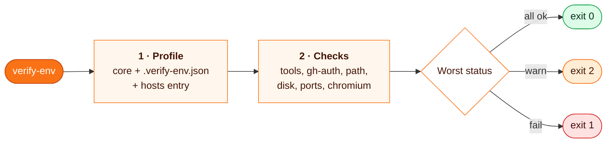

# verify-env

**A read-only doctor that tells you, before a long run starts, whether this host and session can run it: tools and versions on PATH, gh auth, shims, disk, ports and Playwright Chromium.**

```
node ~/.claude/skills/verify-env/scripts/verify-env.mjs            # table
node ~/.claude/skills/verify-env/scripts/verify-env.mjs --json     # {exit, checks:[{id,status,detail}]}
node ~/.claude/skills/verify-env/scripts/verify-env.mjs --profile path/to/profile.json --host <name>
```

| | |
| --- | --- |
| **Fires** | before a long run, test suite or E2E session on a new host or account; when a command fails with ENOENT or "not found"; when tests pass in CI but not locally |
| **Checks** | node, git, npm, pnpm, gh, codex, claude by default, plus whatever a repo profile adds |
| **Returns** | one line per check (`OK`, `WARN`, `FAIL`), exit `0` ok, `1` a failure, `2` only warnings, `3` bad arguments or profile |
| **Never** | installs, writes, kills user processes, or edits PATH; its only network call is `gh auth status` |
| **Needs** | Node 18.15+, no dependencies |

## Why

A missing tool found mid-run costs a failed test suite to untangle; found up front it is one line. The traps are usually host-specific and invisible from inside the code. On one host the profile flagged three before any test ran: `npm` missing from the session PATH, `gh` resolving to the real binary instead of a wrapper shim placed ahead of it, and an AppArmor restriction that breaks the Chromium sandbox.

## How it works



| id | ok when | otherwise |
| --- | --- | --- |
| `tool:<name>` | on PATH, `--version` exits 0, version meets `versions` | `require`: FAIL, `optional`: WARN |
| `gh-auth` | `gh auth status` exits 0 (its output is never printed) | FAIL; WARN if no gh |
| `path:<name>` | `<name>` resolves to the `pathFirst` directory | WARN |
| `disk` | free space in home is at least `minDiskMb` | FAIL |
| `port:<n>` | nothing listens on 127.0.0.1:n | WARN |
| `chromium` | a `chromium*` build in the Playwright browsers dir | FAIL |
| `chromium-sandbox` (Linux) | AppArmor does not restrict unprivileged user namespaces | WARN (Chromium needs `--no-sandbox`) |

A tool that does not answer in 10 s is killed together with the children it started and reported as exit 127.

## Profile

Without a profile only the core runs: `require` node and git; `optional` npm, pnpm, gh, codex, claude; `gh-auth`; `disk` 1024 MB. A repo adds `.verify-env.json` at its root (read from the current directory), or you pass `--profile`:

```json
{
  "require": ["pnpm"],
  "versions": { "node": ">=20" },
  "ports": [5173],
  "chromium": true,
  "minDiskMb": 2048,
  "hosts": {
    "ci-runner-1": { "pathFirst": { "gh": "~/bin" } }
  }
}
```

`require`, `optional`, `versions` and `pathFirst` merge with the core (a tool in `require` leaves `optional`); other keys replace it. The `hosts` entry whose key equals `--host` (default: the machine's hostname) is merged last. Put your own host names and shim directories there.

Project-specific E2E checks (who owns the dev port, auth state age, API DNS) do not belong here; keep them in the project's own doctor.

## Install

```bash
git clone https://github.com/MarcinSufa/skills
cp -r skills/skills/verify-env ~/.claude/skills/
```

Tests: `cd ~/.claude/skills/verify-env && npm test`. Checks reach the OS through a `deps` object, so the unit tests fake Linux and Windows hosts. One test runs the CLI against fake commands on PATH and is skipped on Windows.

## Example

```
OK    tool:node          node 24.16.0 (/usr/local/bin/node)
OK    tool:git           git 2.45.1 (/usr/bin/git)
OK    tool:pnpm          pnpm 11.5.2 (/usr/local/bin/pnpm)
WARN  tool:npm           npm not on PATH
OK    tool:gh            gh 2.86.0 (/usr/bin/gh)
OK    tool:codex         codex 0.162.1 (/usr/local/bin/codex)
OK    tool:claude        claude 2.1.312 (~/.local/bin/claude)
OK    gh-auth            gh auth status: logged in
WARN  path:gh            gh resolves to /usr/bin/gh, expected ~/bin first on PATH
OK    disk               98664 MB free in ~ (min 2048)
WARN  port:5173          port 5173 already in use
OK    chromium           1 Playwright chromium build(s) in ~/.cache/ms-playwright
WARN  chromium-sandbox   unprivileged userns restricted by AppArmor: Chromium sandbox fails, runs need --no-sandbox
```

*An illustration, not real output: the line formats are the script's, the host is made up.* The agent is told to report `FAIL` lines before starting, note `WARN` lines next to any failure they explain, and never fix them itself by installing a tool or editing PATH.

## Limits

- Windows (`.cmd` / `.bat` through `cmd.exe`, `taskkill`) is covered by fakes in the tests, not checked on a live host by the test suite.
- `port:<n>` binds 127.0.0.1:n for a moment: IPv4 only, no owner reported.
- `chromium` sees a `chromium*` directory, not a working browser. `PLAYWRIGHT_BROWSERS_PATH=0` is a WARN, not checked.

## Files

| File | For |
| --- | --- |
| [`SKILL.md`](SKILL.md) | the agent: when to run it, how to act on each status |
| [`scripts/verify-env.mjs`](scripts/verify-env.mjs) | CLI: arguments, profile loading, exit code |
| [`scripts/lib.mjs`](scripts/lib.mjs) | the checks, profile merge, table |
| [`test/`](test/) | unit tests with faked hosts, Windows host shim |
| `README.md` | you |
