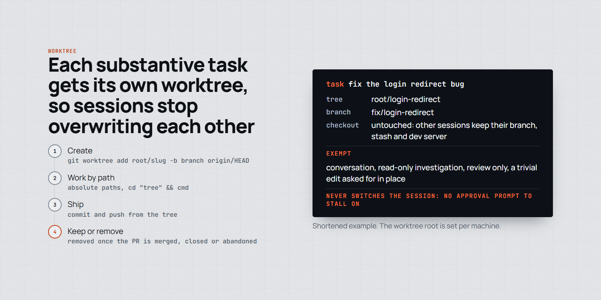
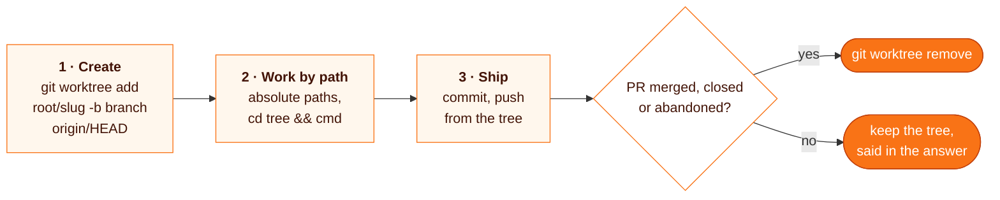

# worktree

**Before the first file edit of a real task in a shared checkout, the agent creates its own git worktree, works there, and says when to keep or remove it.**

<p align="center">
  <picture>
    <source media="(prefers-color-scheme: dark)" srcset="assets/worktree-dark.png">
    
  </picture>
</p>

> The worktree root differs per machine; this repo keeps it in `hosts/<host>.md`. Set your own root and pruning in your global `CLAUDE.md` or the skill.

```
"fix the login redirect bug"     # the agent loads this skill before its first edit
```

| | |
| --- | --- |
| **Fires** | before the first edit of a substantive task: a feature slice, a bug fix, spec or plan work, anything that ends in a commit |
| **Does** | `git worktree add <root>/<slug> -b <branch> origin/HEAD` (the remote default branch), then works in it by absolute path and `cd "<tree>" &&` from the launch directory |
| **Exempt** | conversation, read-only investigation, review only, a trivial single-file edit asked for in place |
| **Never** | uses `EnterWorktree`: any path outside `.claude/worktrees/` asks for approval, and its `name` form puts trees inside the checkout |

## Why

Several agent sessions in one checkout overwrite each other's branch, stash and dev server. A worktree per task removes that. The agent never switches its session into the tree: an approval prompt for `EnterWorktree` can stall an unattended session for hours, so it passes absolute paths to its file tools and prefixes shell commands with `cd "<tree>" &&`.

## How it works



Lessons the skill carries:

- **Trees outside the checkout.** Trees created inside it (`.claude/worktrees/`) broke a gitlink, and test and lint globs picked up the copies.
- **Disk.** A worktree with `node_modules` is about 600 MB; 173 of them once froze a machine. Remove `node_modules` once the PR merges, and prune per host, since dead sessions never run their own cleanup.
- **One writer per tree.** Subagents that write files get `isolation: "worktree"`.
- **Fresh trees miss gitignored config** (env files, Playwright storage state, app config): copy them from the main checkout before running the app or e2e tests.

## Install

```bash
git clone https://github.com/MarcinSufa/skills
cp -r skills/skills/worktree ~/.claude/skills/
```

Then tell the agent your worktree root (the skill reads `<worktree-root>` from a host file) and add a line to your `CLAUDE.md` saying to load the skill before the first edit of a substantive task.

## Files

| File | For |
| --- | --- |
| [`SKILL.md`](SKILL.md) | the agent: the steps, exemptions and gotchas |
| `README.md` | you |
